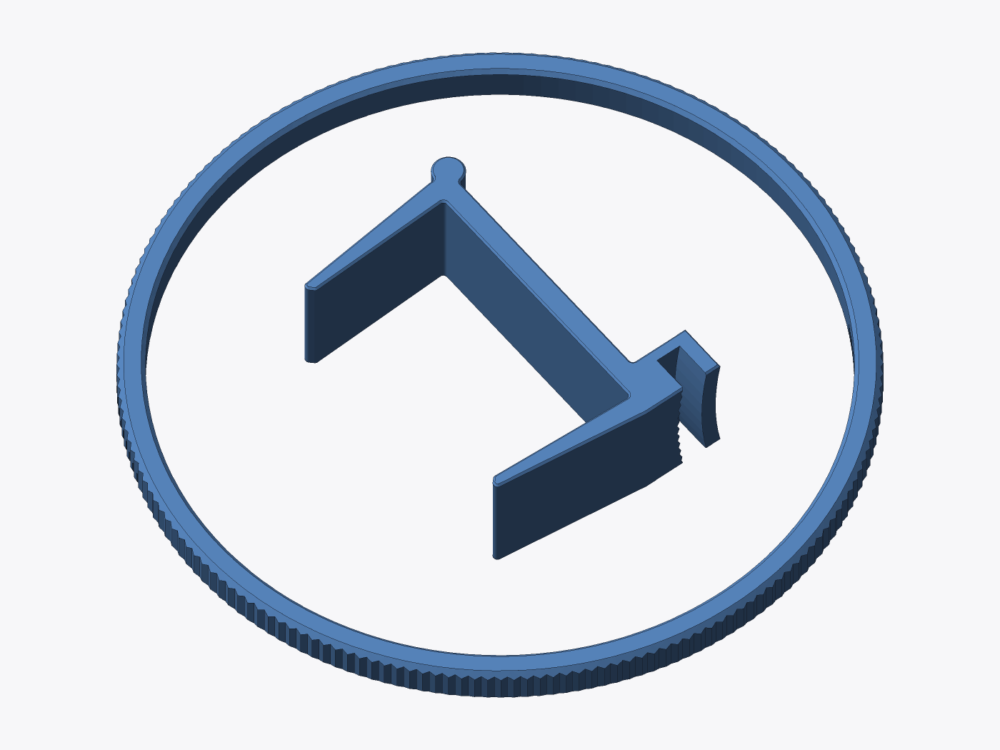
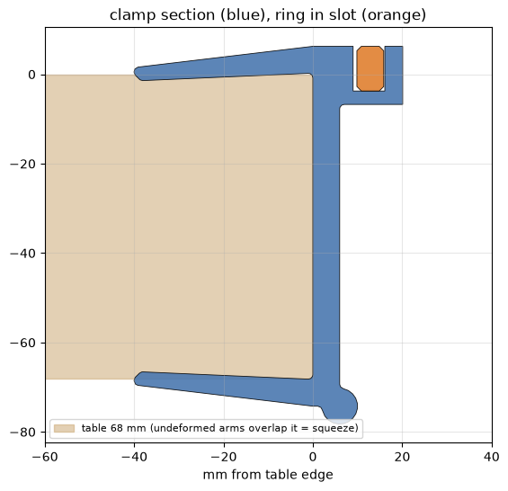

# Trash bag hoop

<p>
  
  
</p>

A 3D-printable hoop that holds a small trash bag open at the edge of a table, like a
basketball ring. A flex clamp pushes onto the table edge without screws, and the ring
locks into it. Ring and clamp print together on one 180 mm bed (Bambu A1 mini). It is
fully parametric: one FreeCAD macro holds every dimension and checks the geometry.

## Size

| | mm |
|---|---|
| Ring | 176 OD at the ribs, 162.8 ID, 6 wide x 10 tall |
| Ring centre | 97 from the table edge, ring top level with the table top |
| Table | 69 thick (measured), clamp reaches 40 over and under |
| Clamp | 61.5 x 30 x 85.5 |
| Plate | 176 x 176 x 30 |
| Filament | ~77 g PLA (ring 40, clamp 37) |

## Design

- **Ring:** 183 vertical ribs, 0.6 mm deep, 3 mm pitch, around the outside for grip and
  feel. They fade out into 1 mm chamfers on the top and bottom edges.
- **Flex clamp:** the two arms lean in, so their tips sit 1.5 mm inside the table on each
  side. Pushed onto the edge, they flex open and spring-grip it. The arms taper from 6 to
  3 mm, so they bend along their length, not at the corner. 45 deg lead-ins on the tips
  guide it on.
- **Ring holder:** a curved slot on the clamp spine. Its outer wall carries the same ribs
  as the ring, 0.25 mm larger, so the ring meshes with it and cannot spin. The bag folds
  over the ring and is pinched in the slot.
- **Load path:** the bag pries the clamp, so the bottom arm tip bears up on the table
  underside. The grip only has to keep the clamp from sliding off.

## Print

`trash-bag-hoop.stl` is the whole plate, already in print orientation: the ring flat,
the clamp on its side inside it. No support.

- **Brim and skirt off.** The plate is 176 mm on a 180 mm bed.
- **Do not auto-arrange or scale.** The STL is one object with both parts placed.
- PETG is better for the clamp: PLA slowly relaxes under a constant grip. PLA works.
- 5 walls (the arms print solid), 20-30 % infill, 0.2 mm layers, 0.4 mm nozzle.

**Print the fit test first.** `trash-bag-hoop-clamp-test.stl` is a 6 mm slice of the
clamp (~7 g) with the same profile. Push it onto your table: it should go on firmly and
stay. Its grip is about 1/5 of the full clamp.

## Build

FreeCAD here is the Flatpak. Pass the macro by absolute path.

```sh
# Full build and checks: writes out/trash-bag-hoop.{FCStd,step,stl}
# and out/trash-bag-hoop-clamp-test.stl.
flatpak run --command=FreeCADCmd org.freecad.FreeCAD "$PWD/build.FCMacro"
```

## Parameters

Change sizes at the top of `build.FCMacro`, not by scaling the STL: scaling also changes
the grip and the slot fit.

| Parameter | Default | |
|---|---|---|
| `TABLE_T` | 69 | Table thickness at the edge. Measure yours |
| `SQUEEZE` | 1.5 | Arm tip into the table, per side. More = tighter grip |
| `SLOT_CL` | 0.25 | Ring-to-slot clearance per side. More if the ring with the bag will not go in |
| `ROOT_T`, `TIP_T` | 6, 3 | Arm thickness at the root and tip |
| `WALL`, `HEIGHT` | 6, 10 | Ring section |
| `RIB_DEPTH`, `RIB_PITCH` | 0.6, 3 | Ring ribs. `RIB_DEPTH = 0` gives a smooth ring |
| `BED`, `BED_MARGIN` | 180, 2 | Bed size. The ring is sized to fill it |
| `TEST_H` | 6 | Fit-test slice thickness |

The checks reject values that do not work, for example an arm stress above 25 MPa, a
ring that hits the slot or spins in it, a part that does not fit the bed, or any overhang
that would need support.

## Not validated

Checked in CAD only. Not yet tested on a real table or with a real bag: the grip
force (~65 N per arm and 15 MPa root stress are beam-formula estimates), PLA creep over
time, and whether the ring goes into the slot with the bag folded over it.

## Downloads

STL, STEP and FCStd are attached to each [release](../../releases). Pushing a `v*`
tag builds them in CI from `build.FCMacro`.

## License

[MIT](LICENSE)
